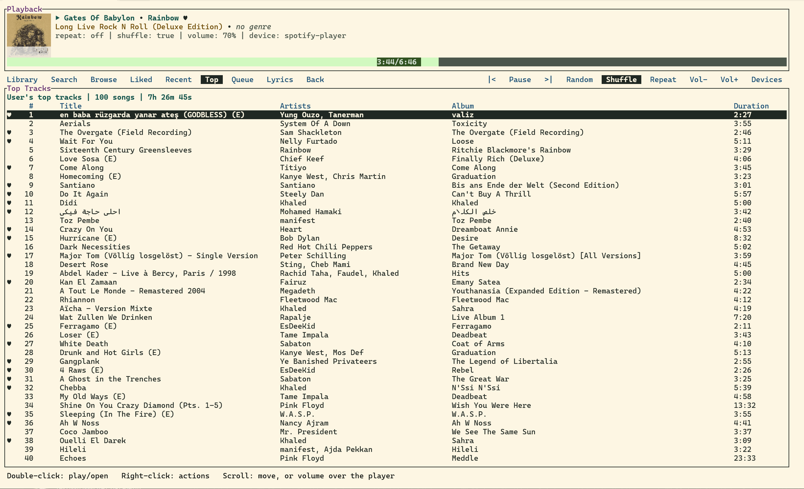
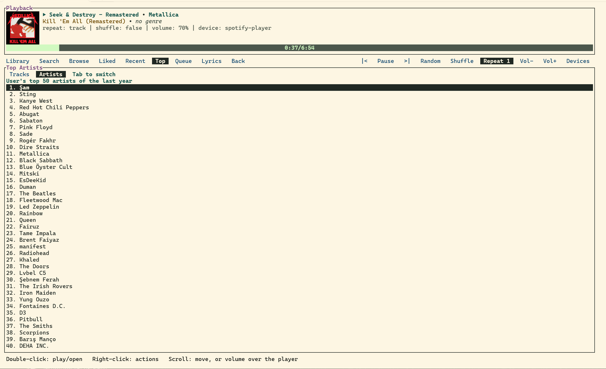
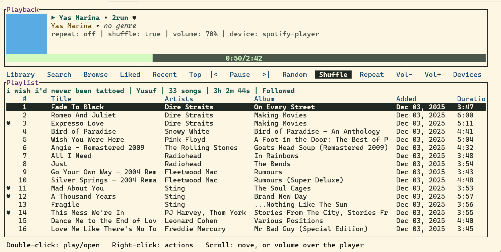
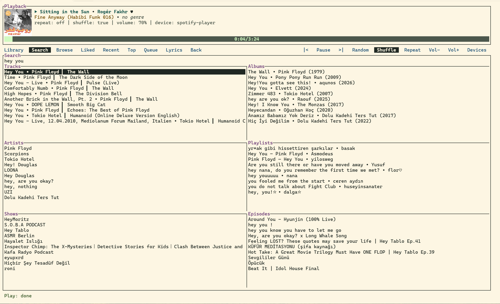
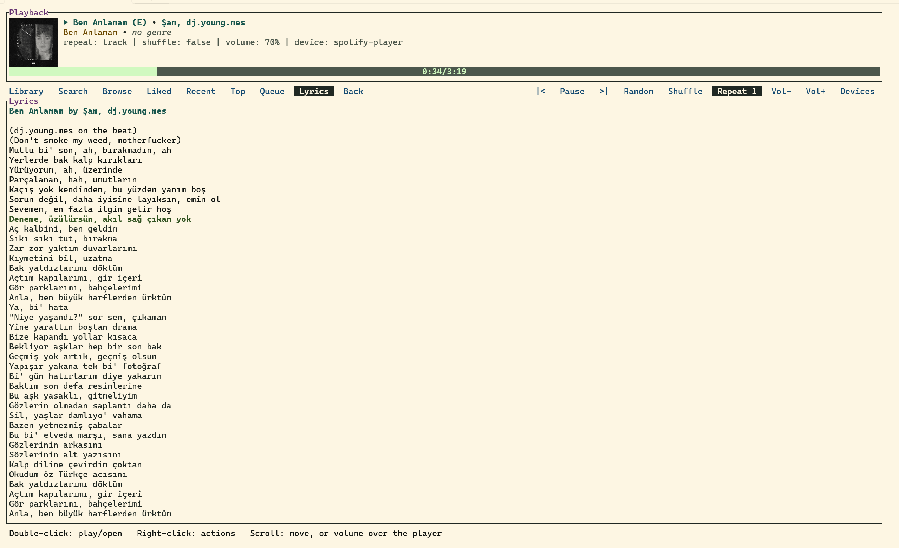
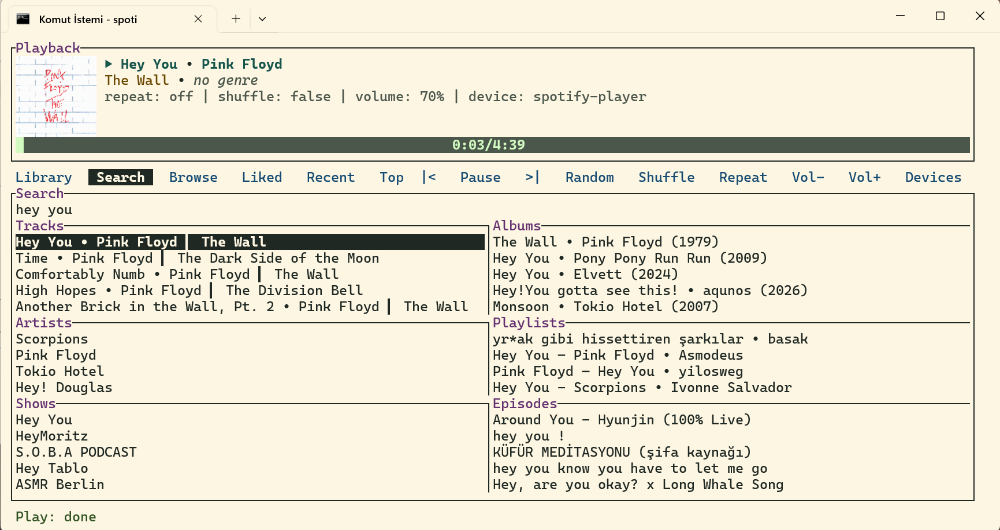
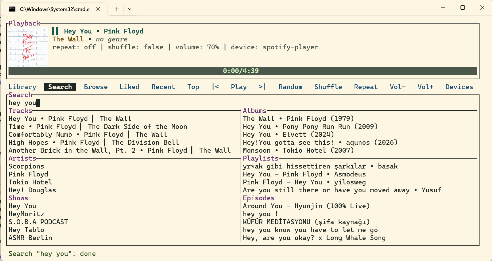

# spoti

Spotify in your terminal. It has a mouse, a status line that actually tells you what happened, and your top songs of the year whenever you want them, not whenever Spotify's marketing team decides it's December.

It's also light. The Spotify desktop app can sit at around 1 GB of RAM on Windows, just to play songs. spoti plays the same songs in 50-60 MB.

It's a fork of [spotify-player](https://github.com/aome510/spotify-player) by aome510, who did the hard part. This fork adds the things I wanted and fixes the things that annoyed me.



## Wrapped, without the December wait

Press `g t` (or click **Top**) and you get your 100 most played songs of roughly the last year, with the total runtime on top, so you can find out exactly how much of your life went into one album. Hit `tab` (or click **Artists**) for your top 50 artists over the same stretch, ranked, no judgment.

This is Spotify's own ranking of your listening, straight from their API. It's not the full Wrapped show: no minutes listened, no "listening age", no animated slides telling you you're in the top 0.5% of fans. Spotify doesn't give apps that data. If you want the real numbers, request your **Extended streaming history** under Privacy on your Spotify account page. It takes up to 30 days, which is still earlier than December if you ask now.

Want more or fewer than 100? Set `top_tracks_limit` in `app.toml`.



## What this fork adds

- **A mouse that does things.** A clickable bar of tabs and buttons: Library, Search, Liked, Top, Friends, Queue, Lyrics, play/pause, shuffle, volume, devices. Double-click plays or opens, right-click opens actions, scroll moves through lists, scroll over the player changes the volume, click the progress bar to seek. Whatever's under the cursor lights up, so you know what you're about to click.
- **A status line.** Every action reports back: `Play: done`, `Search "hey you": done`, red with a reason when something fails, and a countdown when Spotify is rate limiting you. No more pressing play five times and wondering.
- **Friend activity.** The Friends tab (or `g f`) shows what your friends are listening to, like the sidebar in the desktop app, and refreshes every minute while it's open. Double-click a row to play the song, right-click to open the playlist or album it's playing from. Spotify doesn't officially give apps this, so it uses the same private feed as their own apps and could stop working someday.
- **A random button.** Plays a random song from the list you're looking at, or from what's playing, or from your liked songs. For when you have 3,000 liked songs and zero decisions left in you.
- **A queue that fills itself.** Pick a song from search, or paste a track link, and Spotify's recommendations for it line up behind it, like in the official app. No more silence after one song.
- **Fewer rate limits.** Play, pause, skip, seek and volume go straight to the built-in player instead of taking a round trip through Spotify's servers. Your library loads from cache on startup when it's fresh, and bursts of refreshes get merged into one.
- **Its own taskbar button on Windows.** One command and it stops hiding in the pile of terminal windows. See step 6 below.
- **No silent blank pages.** If Spotify sends back a broken playlist or a page fails to load, the status line says so, instead of the app staring into the void forever.







| It tells you when things worked | Every time |
| --- | --- |
|  |  |

## Getting it running

You need Spotify Premium (streaming doesn't work without it). Five minutes, tops.

**1. Get it**

Download the archive for your system from [Releases](https://github.com/Cartograsoda/spoti/releases/latest), unzip it, and put `spoti` (`spoti.exe` on Windows) somewhere on your PATH. On macOS, run `xattr -d com.apple.quarantine spoti` once, or Gatekeeper refuses to start it.

Downloaded builds keep themselves up to date: every start checks for a new release in the background and installs it for the next launch. `spoti update` does it right away, and `enable_auto_update = false` in `app.toml` turns it off.

Or build it yourself with [Rust](https://rustup.rs):

```sh
git clone https://github.com/Cartograsoda/spoti
cd spoti
cargo install --path spotify_player --locked --features image
```

`--features image` gets you album covers in the terminal. The binary is called `spotify_player`. I copied mine to `spoti` because life is short. Builds from source don't update themselves.

**2. Make your own Spotify client ID (don't skip this)**

A client ID is how Spotify knows which app is asking for your data, and Spotify caps how many requests each one can make. Without your own, the app borrows ncspot's, the same one every other terminal Spotify user borrows, so you wait in line behind strangers. That's the "it sits there doing nothing for 30 seconds" experience. It's not frozen, it's queueing.

- Create an app on the [Spotify developer dashboard](https://developer.spotify.com/dashboard).
- When it asks which APIs you'll use, tick **Web API** only.
- Add `http://127.0.0.1:8989/login` as a redirect URI. Exactly that, character for character.

**3. Tell spoti about it**

Copy the client ID from the dashboard into `~/.config/spotify-player/app.toml` (create the file if it isn't there):

```toml
client_id = "your-client-id"
```

**4. Log in**

```sh
spoti authenticate
```

Approve everything in the browser. It asks more than once; that's normal.

**5. Play something**

```sh
spoti
```

One catch: Spotify doesn't let new apps read some things, like songs in other people's playlists or an artist's top tracks. Those requests quietly fall back to the shared ID, so they can still be slow sometimes. Your own playlists stay fast.

**6. Windows: give it its own taskbar button (optional)**

Windows Terminal stacks all its windows behind one taskbar button, so spoti ends up in a pile with every other terminal you have open, and sooner or later you close the wrong one. Run this once:

```sh
spoti setup-window
```

It downloads a portable copy of Windows Terminal from Microsoft's GitHub releases (about 11 MB, signature checked) into `%LOCALAPPDATA%\spoti`. From then on, starting spoti from Windows Terminal reopens it in its own window, with its own taskbar button and the same colours as the tab you started it from. Pin **Spoti** from the Start menu to put a green icon on that button. `--in-place` runs it in the current tab instead, and `setup-window --remove` undoes the whole thing.

### Or let your coding agent do it

Paste this into Claude Code, Codex, Cursor or whatever you use. It does the setup and only stops for the parts that need you: the Spotify dashboard and the browser login.

```text
Install spoti, a terminal Spotify client, from https://github.com/Cartograsoda/spoti on this machine, following the "Getting it running" section of its README.

- If `cargo` isn't available, install Rust with rustup first.
- Build with `cargo install --path spotify_player --locked --features image`, then copy the installed `spotify_player` binary to `spoti` (`spoti.exe` on Windows) in the same folder.
- I need my own Spotify client ID. Walk me through creating an app at https://developer.spotify.com/dashboard (tick Web API only, redirect URI exactly `http://127.0.0.1:8989/login`), wait for me to paste the client ID, then set `client_id = "<id>"` in `~/.config/spotify-player/app.toml`, keeping anything already in that file.
- Don't run `spoti authenticate` or `spoti` yourself, they're interactive. Tell me to run `spoti authenticate` in my own terminal and approve everything in the browser (it asks more than once).
- On Windows, if I use Windows Terminal, run `spoti setup-window` and tell me to pin "Spoti" from the Start menu to the taskbar.
- Finish by telling me to start it with `spoti`.
```

## Keys worth knowing

| Key | Does |
| --- | --- |
| `space` | play / pause |
| `n` / `p` | next / previous |
| `.` | random song |
| `g t` | top tracks |
| `g T` | top artists |
| `g f` | what your friends are listening to |
| `tab` | switch between top tracks and artists |
| `g y` | liked songs |
| `g l` | library |
| `g s` | search |
| `l` | lyrics |
| `z` | queue |
| `D` | switch device |
| `?` | every other command |
| `q` | quit |

All the config options are in [docs/config.md](docs/config.md). Everything else (themes, Spotify Connect, CLI commands, the daemon) works like upstream, so the [original README](https://github.com/aome510/spotify-player#readme) has you covered.

## Known weirdness

- Artist pages sometimes don't load. Spotify blocks newer apps from artist top tracks and related artists, so those go through the shared ID and get rate limited. Give it a minute.
- Built and used on Windows. Upstream runs on Linux and macOS too and nothing here should break that, but I haven't checked.

## Credits

Built on [spotify-player](https://github.com/aome510/spotify-player) by aome510, with [librespot](https://github.com/librespot-org/librespot), [ratatui](https://github.com/ratatui/ratatui) and [rspotify](https://github.com/ramsayleung/rspotify) doing the heavy lifting. MIT licensed, see [LICENSE](LICENSE).
